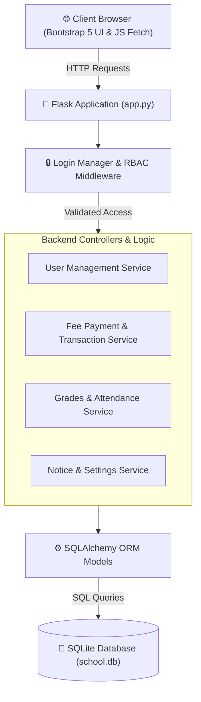
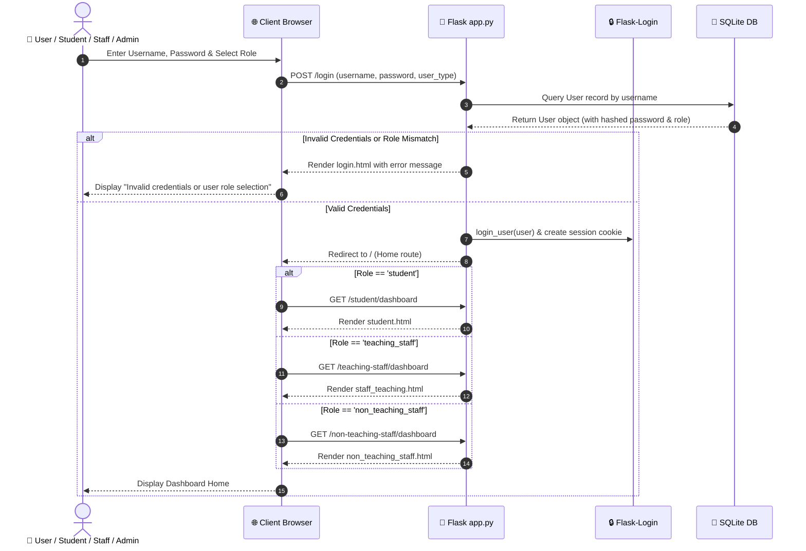
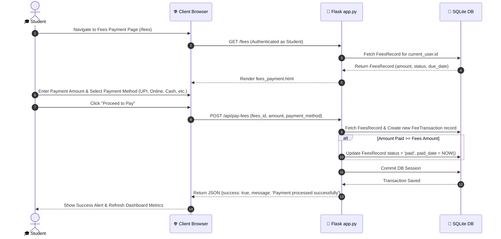
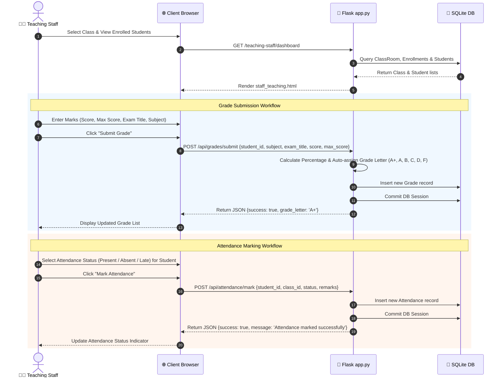
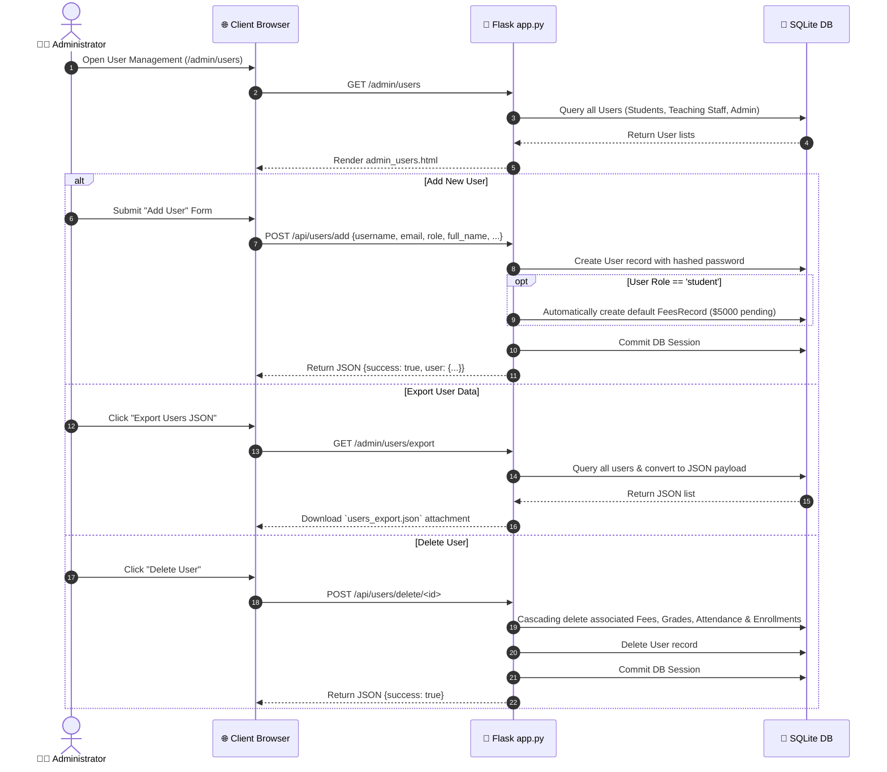
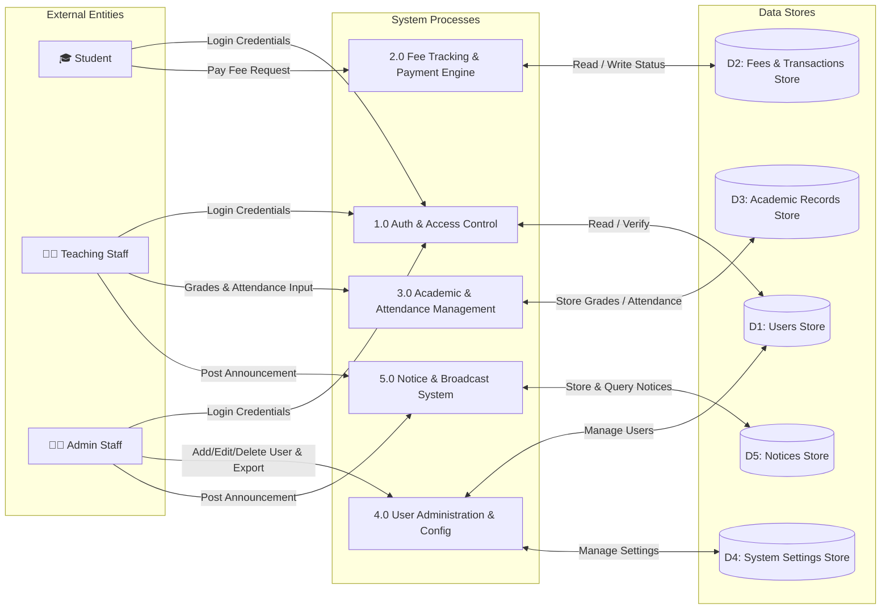
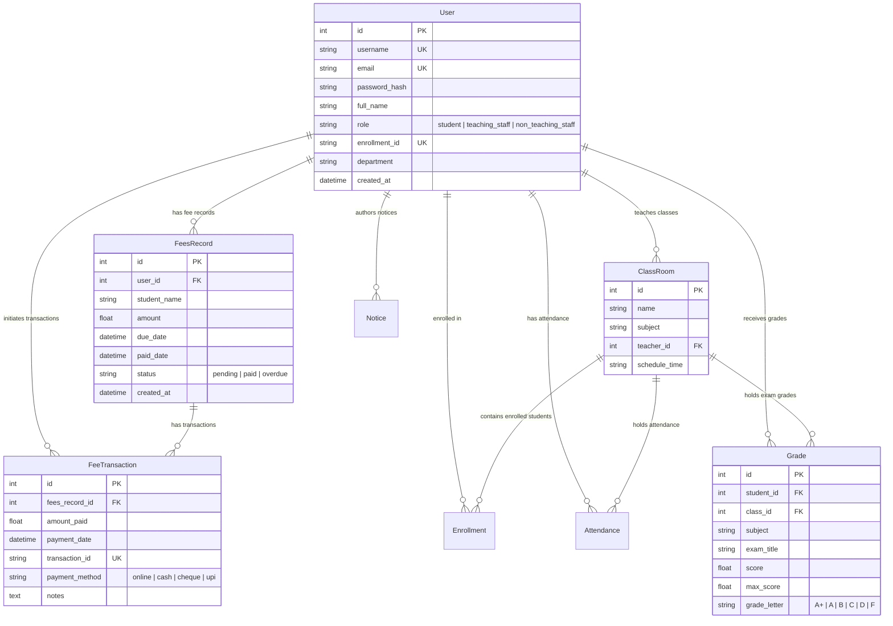

# 🏫 School Management System

> A comprehensive, web-based school management application built with **Flask**, **SQLAlchemy**, **SQLite**, and **Bootstrap 5**, providing role-based portals for **Students**, **Teaching Staff**, and **Administrative / Non-Teaching Staff**.

---

## 📊 1. Current Progress & Status Overview

### Overall Project Completion: **100% Core MVP Completed**

| Feature / Module | Status | Progress | Description |
| :--- | :---: | :---: | :--- |
| **Authentication & RBAC** | ✅ Completed | 100% | Multi-role login (Student, Staff, Admin), password hashing, session management, route protection. |
| **Student Dashboard** | ✅ Completed | 100% | Fee status tracking, attendance metrics, academic grades history, interactive notice board. |
| **Fees & Payment System** | ✅ Completed | 100% | Online fee payment gateway, transaction logs, payment method selector, real-time status update. |
| **Teaching Staff Portal** | ✅ Completed | 100% | Class schedules, grade entry with letter grading auto-calc, attendance marking, notice broadcasting. |
| **Admin & User Management** | ✅ Completed | 100% | CRUD operation for all users, JSON data export, automatic fee initialization for students. |
| **Financial & System Analytics**| ✅ Completed | 100% | Collection metrics, pending fee summary, transaction logs, system settings configuration. |
| **Notice Board & Announcements**| ✅ Completed | 100% | Role-targeted announcements (All, Student, Staff) with real-time dynamic display. |
| **RESTful API Backend** | ✅ Completed | 100% | Full JSON APIs for users, fees, grades, attendance, notices, and configuration settings. |
| **Notifications (Email/SMS)** | ⏳ Roadmap (Phase 2) | 0% | Planned automated email/SMS reminders for fee payment & attendance alerts. |
| **Parent Portal & QR Attendance**| ⏳ Roadmap (Phase 2) | 0% | Planned parent dashboard view & automated QR code attendance scanning. |

---

## 🔄 2. System Flow Sequences & Diagrams

### 2.1 System High-Level Architecture Flow


---

### 2.2 User Authentication & Role Routing Flow Sequence


---

### 2.3 Student Fee Payment Flow Sequence


---

### 2.4 Teaching Staff Grade & Attendance Marking Flow Sequence


---

### 2.5 Admin User Management & System Configuration Flow Sequence


---

### 2.6 Data Flow Diagram (DFD Level-1)


---

## 🗄️ 3. Database Schema Entity-Relationship Model



---

## 💻 4. Technology Stack & Project Structure

### Technology Stack
- **Backend Framework**: Python Flask (v2.3.2)
- **Database & ORM**: SQLite + Flask-SQLAlchemy
- **Authentication**: Flask-Login + Werkzeug Security (SHA-256 Password Hashing)
- **Frontend Layer**: HTML5, Custom CSS3, Bootstrap 5, JavaScript (Fetch API)
- **Data Export**: Built-in JSON streaming service

### Directory Structure
```
project/
├── app.py                          # Main Flask application, ORM models & API routes
├── config.py                       # Application configuration settings
├── init_db.py                      # Database initialization & sample data generator
├── wsgi.py                         # WSGI production server entry point
├── requirements.txt                # Python package dependencies
├── readme.md                       # Complete documentation & flow sequence diagrams
├── PROJECT_SUMMARY.md              # Project status and completion log
├── QUICK_START.md                  # Detailed setup and launch instructions
│
├── templates/                      # Jinja2 HTML Templates
│   ├── base.html                  # Master layout with responsive navbar & footer
│   ├── index.html                 # Public landing home page
│   ├── login.html                 # Multi-role authentication page
│   ├── student.html               # Student dashboard
│   ├── staff_teaching.html        # Teaching staff dashboard
│   ├── non_teaching_staff.html    # Administrative staff dashboard
│   ├── fees_payment.html          # Student fee payment portal
│   ├── admin_users.html           # User management portal
│   └── profile.html               # User profile & password update page
│
├── styles/
│   └── style.css                  # Custom CSS styles, themes & responsive layouts
│
└── school.db                       # SQLite database instance (generated on setup)
```

---

## ⚡ 5. REST API Endpoints Reference

| Category | Endpoint | Method | Required Access | Description |
| :--- | :--- | :---: | :---: | :--- |
| **Authentication** | `/login` | `GET / POST` | Public | Authenticate user credentials and assign session |
| | `/logout` | `GET` | Authenticated | Destroy current active session |
| | `/profile` | `GET / POST` | Authenticated | View profile & change password |
| **Student** | `/student/dashboard` | `GET` | Student | View student metrics, grades, attendance & fees |
| | `/fees` | `GET` | Student | Access student fee details & payment modal |
| | `/api/pay-fees` | `POST` | Student | Process fee payment transaction |
| **Teaching Staff** | `/teaching-staff/dashboard` | `GET` | Teaching Staff | Access assigned classes & student rosters |
| | `/api/grades/submit` | `POST` | Staff / Admin | Record grades & auto-calculate grade letters |
| | `/api/attendance/mark` | `POST` | Staff / Admin | Record student attendance status |
| **Admin** | `/non-teaching-staff/dashboard`| `GET` | Admin Staff | View financial overview & transaction metrics |
| | `/admin/users` | `GET` | Admin Staff | View & manage user accounts |
| | `/api/users/add` | `POST` | Admin Staff | Add new user (auto-creates fee record if student) |
| | `/api/users/edit/<id>` | `POST` | Admin Staff | Update user account details |
| | `/api/users/delete/<id>` | `POST` | Admin Staff | Delete user account & clear dependent data |
| | `/admin/users/export` | `GET` | Admin Staff | Download user records as JSON format |
| | `/api/fees/create` | `POST` | Admin Staff | Issue new fee record for a student |
| | `/api/notices/create` | `POST` | Staff / Admin | Post announcement to notice board |
| | `/api/settings/update` | `POST` | Admin Staff | Update system settings |

---

## 🚀 6. Installation & Quick Start Guide

### Step 1: Environment Setup
```bash
# Navigate to the project directory
cd project

# Create a virtual environment
python -m venv .venv

# Activate the virtual environment
# On Windows (PowerShell):
.venv\Scripts\Activate.ps1
# On macOS/Linux:
source .venv/bin/activate
```

### Step 2: Install Dependencies
```bash
pip install -r requirements.txt
```

### Step 3: Initialize Database with Seed Data
```bash
python init_db.py
```
> This creates `school.db`, builds database tables, and populates initial sample users, classes, grades, attendance, fees, and notices.

### Step 4: Run Application
```bash
python app.py
```
Open your browser and navigate to: **`http://127.0.0.1:5000`**

---

## 🗝️ 7. Default Demo Credentials

| Role | Username | Password | Access Rights |
| :--- | :--- | :--- | :--- |
| **Student** | `student1` | `password123` | Student Dashboard, Fees Payment, Grades View |
| **Student** | `student2` | `password123` | Student Dashboard (Overdue status sample) |
| **Student** | `student3` | `password123` | Student Dashboard (Paid status sample) |
| **Teaching Staff** | `staff1` | `password123` | Math Classes, Mark Attendance, Grade Entry |
| **Teaching Staff** | `staff2` | `password123` | Physics Classes, Attendance, Grade Entry |
| **Administrator** | `admin1` | `password123` | Full System Access, User CRUD, Financial Reports |

---

## 🔮 8. Roadmap & Future Enhancements

- [ ] **Automated Email & SMS Alerts**: Send instant notifications upon fee receipt generation or overdue dates.
- [ ] **QR Code Attendance System**: Allow teachers to take attendance via mobile camera QR scanning.
- [ ] **Parent Portal Module**: Dedicated portal for parents to track attendance, report cards, and pay fees.
- [ ] **Online Examination System**: Multiple choice & quiz engine integrated with auto-grading.
- [ ] **PDF Receipt Generator**: Export formal fee payment receipts and student ID cards in PDF format.
